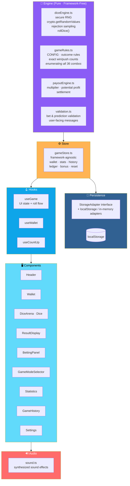
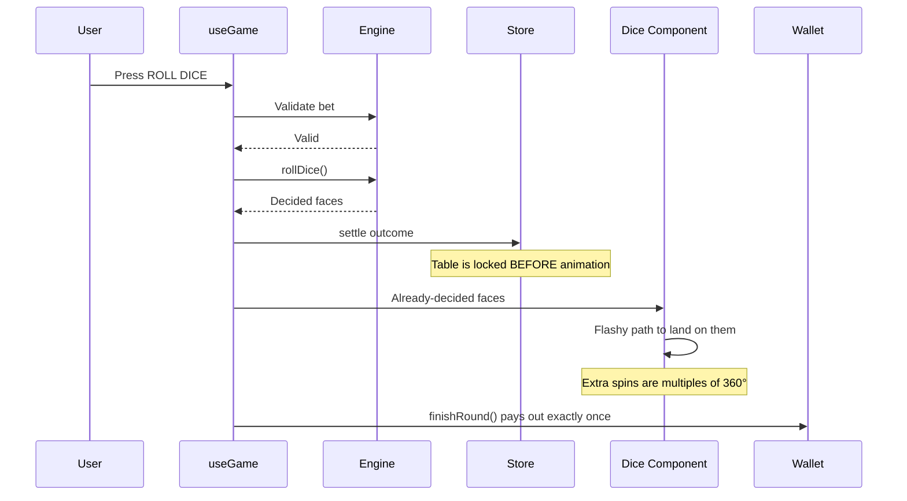

# 🎲 DICE RUSH — Guess. Roll. Win.

<div align="center">


**A polished, casino-style dice betting game.**

*Predict · Bet virtual coins · Watch 3D dice tumble · Transparent odds, honest payouts*

[🎮 Game Rules](#-game-rules) • [✨ Features](#-features) • [📐 Payouts](#-payout-calculation) • [🏗️ Architecture](#-architecture) • [🧪 Testing](#-testing)

</div>

---

## 📖 Overview

**DICE RUSH** is a **polished, casino-style dice betting game** built with **React + TypeScript + Vite**.

### Core Idea

> **Odds are transparent. Every payout is derived from the real dice probabilities.**
>
> **No real money is ever involved.**

### The Round Flow


---

## ✨ Features

<div align="center">

| 🎯 4 Game Modes | 💰 Fair Payouts |
|:---:|:---:|
| **Exact Number** *(2–12)* · **HIGH / LOW** *(7 is a push)* · **EVEN / ODD** · **DOUBLES** | Computed from **true probabilities** · **configurable 3% house edge** · **potential profit shown before every roll** |
| **💼 Virtual Wallet** | **🎲 3D CSS Dice** |
| **1,000 starting coins** · bets **10–500** *(never above your balance)* · **quick-bet chips** · **MAX button** · **daily +250 bonus** · **reset with confirmation** | **Tumble, bounce, and land on the engine's result** · **gold particle burst** on a win · **subtle red pulse** on a loss · **animated total** |
| **🔊 Synthesized Sound** | **📊 Statistics Dashboard** |
| **Web Audio API** — **no audio files** · **mute toggle** in the header and settings | Rounds · wins · losses · win rate · wagered · profit/loss · biggest win · streak · **SVG charts** *(balance over time, results donut, totals histogram vs. expected)* |
| **📜 History** | **💾 Persistence** |
| Every round *(dice, total, prediction, bet, result, coins)* · filters **All / Wins / Losses / Pushes** · **transaction ledger** | Wallet · stats · history · sound preference · bonus status — **all in `localStorage`** |
| **📱 Responsive** | **⚙️ Odds Table** |
| Desktop · tablet · mobile · **respects `prefers-reduced-motion`** | In **Settings** — chance, payout multiplier, and profit for every bet |

</div>

---

## 🛠️ Tech Stack

<div align="center">

| Library | Role |
|---------|------|
| **React 18** | UI |
| **TypeScript** *(strict)* | Language |
| **Vite 5** | Build tool |
| **Vitest** | Testing |
| **Plain CSS** | Glassmorphism and **CSS 3D transforms** |
| **Web Crypto API** | Secure randomness |
| **Web Audio API** | Synthesized sound |

</div>

---

## 🚀 Getting Started

```bash
npm install
npm run dev        # start the dev server (http://localhost:5173)
```

### 🛠️ Commands

<div align="center">

| Command | What It Does |
|---------|--------------|
| **`npm run dev`** | Dev server with hot reload |
| **`npm run typecheck`** | TypeScript type check |
| **`npm test`** | Run all unit tests once *(Vitest)* |
| **`npm run test:watch`** | Tests in watch mode |
| **`npm run build`** | Type check + production build into `dist/` |
| **`npm run preview`** | Serve the production build locally |

</div>

---

## 🎮 Game Rules

### 1. Place Your Bet

**Pick a mode and a prediction, enter a bet** *(10–500 coins, up to your balance)*, **press ROLL DICE**.

### 2. The Roll

**Two dice are rolled by the game engine** — **cryptographically secure RNG.**

### 3. Outcomes

<div align="center">

| Mode | Wins When | Chance |
|:----:|-----------|:------:|
| **Exact Number** | Total equals your number | **1/36** *(2, 12)* up to **6/36** *(7)* |
| **LOW** | Total **2–6** | **15/36** |
| **HIGH** | Total **8–12** | **15/36** |
| **EVEN / ODD** | Total has that parity | **18/36** |
| **DOUBLES** | Both dice show the same number | **6/36** |

</div>

> 💡 **A total of 7 on HIGH / LOW is a PUSH — your bet is refunded.**

### 🛡️ Safety Guarantees

- **The wallet can NEVER go negative**
- **A new roll cannot start while one is in progress**

---

## 📐 Payout Calculation

> **For a prediction with win probability `pWin` and push probability `pPush`, the payout multiplier (stake included) is:**

```
multiplier = (1 − houseEdge − pPush) / pWin
```

> ✅ **So the expected return per coin is exactly `1 − houseEdge` (97%) for EVERY bet.**

### 💡 How Profit Is Calculated

<div align="center">

| Outcome | What Happens |
|:-------:|-------------|
| **Win** | Net profit = `bet × (multiplier − 1)` — **rounded DOWN to whole coins** *(so rounding never reduces the house edge)* |
| **Loss** | The wager is **deducted** |
| **Push** | The wager is **refunded** |

</div>

### 📊 Examples *(3% edge)*

<div align="center">

| Prediction | Multiplier |
|:----------:|:----------:|
| **Exact 7** | **5.82×** |
| **Exact 2 or 12** | **34.92×** |
| **Doubles** | **5.82×** |
| **EVEN / ODD** | **1.94×** |
| **HIGH / LOW** | **≈1.93×** |

</div>

> 💡 **HIGH / LOW is slightly lower than 1.94× because the refunded 7 is accounted for.**

### ⚙️ Tuning the House Edge

**Change `CONFIG.HOUSE_EDGE` in `src/engine/gameRules.ts`** — **all payouts, UI, and tests follow.**

---

## 🏗️ Architecture

### System Overview



### 📂 Project Layout

```
src/
├── engine/              Pure, framework-free game logic
│   ├── diceEngine.ts    secure RNG
│   │                    (crypto.getRandomValues, rejection sampling)
│   │                    rollDice()
│   ├── gameRules.ts     CONFIG, outcome rules
│   │                    exact win/push counts
│   │                    by enumerating all 36 combos
│   ├── payoutEngine.ts  multiplier, potential profit, settlement
│   └── validation.ts    bet & prediction validation
│                        with user-facing messages
│
├── store/
│   └── gameStore.ts     Framework-agnostic store
│                        wallet, stats, history, ledger, bonus, reset
│
├── storage/             StorageAdapter interface
│                        + localStorage / in-memory adapters
│
├── hooks/               useGame (UI state + roll flow)
│                        useWallet · useCountUp
│
├── components/          Header · Wallet · DiceArena · Dice
│                        ResultDisplay · BettingPanel
│                        GameModeSelector · Statistics
│                        GameHistory · Settings
│
├── audio/
│   └── sound.ts         Synthesized sound effects
│
├── types/
│   └── game.ts          Shared types
│
└── utils/
    └── formatCoins.ts   Formatting helpers

tests/                   Vitest suites for engine
                         payouts, rules and the store
```

### 🔒 The Animation Never Decides the Result

> **This is the most important design principle in DICE RUSH.**



<div align="center">

| Guarantee | Implementation |
|-----------|---------------|
| **🎬 Animation is cosmetic** | `startRound()` **validates the bet**, **rolls the dice with the engine**, **settles the outcome**, and **locks the table** **BEFORE any animation starts** |
| **🎯 Dice land on the result** | The dice component only receives the **already-decided faces** and **chooses a flashy path to land on them** *(extra spins are multiples of 360°)* |
| **💰 Payout happens exactly once** | `finishRound()` **pays out exactly once** |
| **🔄 Refreshing can't dodge a loss** | **If the page is closed mid-roll**, the pending round is **settled on the next load** |

</div>

### 🔌 Swapping in a Backend

> **Implement `StorageAdapter`** *(`load` / `save` / `clear`)* **and pass it to `createGameStore(adapter)`**.
>
> **Nothing else needs to change.**

### Design Principles

<div align="center">

| Principle | Implementation |
|-----------|---------------|
| **🧠 Engine is pure** | Dice, rules, payouts, and validation are **framework-free TypeScript** — testable without React |
| **📐 Payouts are derived, not typed** | Multipliers are computed from **real dice probabilities** — **every bet returns 97% expected value** |
| **🔐 RNG is cryptographic** | **`crypto.getRandomValues` with rejection sampling** — **not `Math.random()`** |
| **🎬 Result is decided before animation** | **Table is locked, outcome is settled, then animation plays** — **the animation can't cheat** |
| **💾 Interrupted rounds settle on reload** | Closing the tab mid-roll **cannot dodge a loss** |
| **💰 Wallet can't go negative** | Balance is checked on every bet |
| **🔄 One roll at a time** | New rolls can't start while one is in progress |
| **📊 Full history and stats** | Every round is recorded — with filters, a ledger, and SVG charts |
| **♿ Reduced motion respected** | `prefers-reduced-motion` disables animations |
| **🔌 Storage is abstracted** | `StorageAdapter` makes a backend swap a one-line change |

</div>

---

## 🧪 Testing

```bash
npm test
```

### What the Test Suite Covers

<div align="center">

| Area | Coverage |
|------|:--------:|
| **Dice generation and RNG bounds** | ✅ |
| **All 36 combinations** for every prediction type | ✅ |
| **Win / lose / push logic** | ✅ |
| **Probabilities** | ✅ |
| **Payout maths** | ✅ |
| **RTP = 97%** for every bet | ✅ |
| **Invalid bets** | ✅ |
| **Insufficient balance** | ✅ |
| **Wallet updates** — exactly once per round | ✅ |
| **Duplicate-roll prevention** | ✅ |
| **Stats and streaks** | ✅ |
| **Persistence across reloads** | ✅ |
| **Interrupted rounds** | ✅ |
| **Daily bonus and reset** | ✅ |

</div>

---

## 🗺️ Roadmap

### ✅ Current

- [x] React 18 + TypeScript *(strict)* + Vite 5 foundation
- [x] Four game modes — Exact Number, HIGH / LOW, EVEN / ODD, DOUBLES
- [x] Transparent odds derived from real dice probabilities
- [x] Configurable 3% house edge
- [x] Potential profit shown before every roll
- [x] 1,000 starting coins with bets from 10 to 500
- [x] Bets never allowed above balance
- [x] Quick-bet chips and a MAX button
- [x] Daily +250 coin bonus
- [x] Reset with confirmation
- [x] 3D CSS dice with tumble, bounce, and landing on the engine's result
- [x] Gold particle burst on wins and a subtle red pulse on losses
- [x] Animated total display
- [x] Synthesized sound effects with a mute toggle in the header and settings
- [x] Statistics dashboard — rounds, wins, losses, win rate, wagered, profit/loss, biggest win, streak
- [x] SVG charts — balance over time, results donut, totals histogram vs. expected
- [x] Full round history with All / Wins / Losses / Pushes filters
- [x] Transaction ledger
- [x] Wallet, stats, history, sound preference, and bonus status persisted in `localStorage`
- [x] Responsive layouts for desktop, tablet, and mobile
- [x] `prefers-reduced-motion` respected
- [x] Odds table in Settings showing chance, multiplier, and profit for every bet
- [x] Cryptographic RNG via `crypto.getRandomValues` with rejection sampling
- [x] Result decided before animation begins
- [x] Table locked before animation, paid out exactly once
- [x] Interrupted rounds settled on next load
- [x] Pure engine — no framework dependencies
- [x] Framework-agnostic store
- [x] `StorageAdapter` interface with localStorage and in-memory adapters
- [x] Vitest suite covering engine, payouts, rules, and store
- [x] RTP = 97% verified by tests

### 🔜 Future Ideas

- [ ] **Server-backed wallet** — via a custom `StorageAdapter`
- [ ] **Local leaderboards** — best balance or longest streak
- [ ] **Achievements** — milestone badges
- [ ] **Additional game modes** — triples, sums, exact pairs
- [ ] **Configurable house edge** exposed in Settings
- [ ] **Session summary** — a shareable card of the session
- [ ] **Sound pack variants** — synthesized per theme
- [ ] **Accessibility audit** — deeper screen reader support for the dice roll
- [ ] **PWA support** — install and play offline
- [ ] **Localization** — bilingual UI

---

## 🤝 Contributing

Contributions are welcome. Please:

1. Fork the repository
2. **Keep the engine pure** — `src/engine/` must remain framework-free
3. **Keep payouts derived from probabilities** — never hard-code a multiplier that wasn't computed
4. **Keep the RNG cryptographic** — `crypto.getRandomValues`, never `Math.random()`
5. **Keep the result decided before animation** — animation is cosmetic and must never affect the outcome
6. **Preserve exactly-once settlement** — a round must pay out once and only once
7. **Keep the wallet non-negative**
8. **Keep the RTP test passing** — 97% for every bet
9. **Update tests** when changing rules, payouts, or the engine
10. Submit a Pull Request

### Guidelines

- **Never let animation affect the result**
- **Never pay out twice**
- **Never allow a bet greater than the balance**
- **Never break `localStorage` compatibility** without a migration path
- **Never claim real-money functionality** — all coins are virtual
- **Never present a stub as a feature**

---

## 📜 License

**MIT** — for demonstration and entertainment.

> ⚠️ **Virtual coins have no monetary value.**

---

## 🙏 Acknowledgments

- **Web Crypto API** — for randomness you can trust
- **Web Audio API** — for a game with zero audio files
- **CSS 3D transforms** — for dice that actually feel like dice
- **Every game that taught you what "house edge" means** — this one's for you

---

<div align="center">

### 🎲 GUESS. ROLL. WIN.

**A polished, casino-style dice betting game.**

**Transparent odds. Honest payouts. Virtual coins only.**

<br>

> ⚠️ **No real money is ever involved.**

<br>

⭐ If DICE RUSH rolled your way, consider giving it a star.

<br>

[⬆ Back to Top](#-dice-rush--guess-roll-win)

</div>
